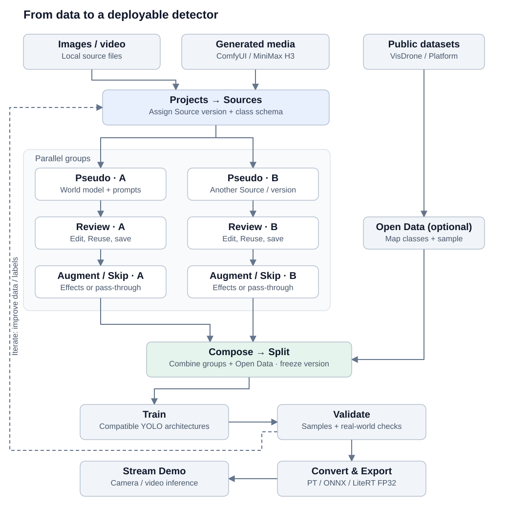

# ObjectAutoLabel

English · [繁體中文](README.zh.md)

A local-first workspace for object-detection datasets and models. Prepare images or video, generate pseudo labels, review boxes, augment and split data, train YOLO models, and export results in one WebUI.

## Purpose

- **Fast pseudo labeling and YOLO training.** Use prompt-driven vision models (YOLO-World / YOLOE) to generate bounding-box labels, then train compatible YOLO architectures such as YOLO11 and YOLO26.
- **Local-first, API-driven iteration.** Keep labeling and training on your own machine. Local AI agents can call the REST API to generate labels, build splits, submit training jobs, and inspect results. A built-in MCP server is not currently included.
- **Generated data to task-specific detectors.** Import images from ComfyUI or frames from [MiniMax H3 videos](https://comfy.org/minimax-h3/) into the same labeling and training pipeline. This workflow requires no simulator or separate sim2real conversion step; real-world performance still needs validation.


## Quick start

Requires Linux, Docker Compose, and an NVIDIA GPU runtime (driver and NVIDIA Container Toolkit). Supports x86_64 desktops and Jetson ARM64; the Jetson image must match the host's JetPack/L4T version.

```bash
git clone https://github.com/a0665x/ObjectAutoLabel.git
cd ObjectAutoLabel

# Install the pseudo-label model and prompt encoders; first download needs internet
scripts/install-world-model.sh

# Install YOLO11n starting weights
scripts/install-input-model.sh

# First installation: select the platform, build the image, and start
./run.sh
```

Open [http://127.0.0.1:8501/](http://127.0.0.1:8501/). On Jetson, use the LAN address printed by the launcher.

Bare `./run.sh` builds and starts only when the image is missing. With an existing image:

| Action | Command |
| --- | --- |
| Start, including after reboot; no rebuild | `./run.sh --up` |
| Rebuild and start after code updates | `./run.sh --rebuild` |
| Status / logs | `./run.sh --status` / `./run.sh --logs` |
| Stop | `./run.sh --down` |
| Select platform | `./run.sh --mode desktop` / `./run.sh --mode jetson` |

Rebuilding interrupts running jobs; wait for training and other tasks to finish. It does not clear datasets or models.

## Data and models

Place image folders or videos in `data/input/`, then select them in Sources. The corresponding container path is `/app/data/input/`.

```text
data/input/        Original images and videos
data/projects/     Project images, labels, splits, and model outputs
data/opendata/     Shared public-dataset cache
world_model/       Pseudo-label models and prompt encoders
input_model/       Training starting weights
output_model/      Project model index
```

Optional models:

```bash
# Use YOLO-World v2 Small for pseudo labeling
scripts/install-world-model.sh yolov8s-worldv2.pt

# Add YOLO26n training weights
scripts/install-input-model.sh yolo26n.pt
```

Installers verify SHA-256 checksums. Model folders are bind-mounted: refresh the browser after adding weights; no rebuild is needed. Datasets, weights, secrets, and runtime logs are excluded from Git.

## Workflow



[Edit the flowchart in draw.io](docs/diagrams/workflow.drawio) · English / 繁體中文 pages

- **Sources → Pseudo**: process images or extract video frames, assign the Source version, and commit classes and prompts. Reprocessing the same path requires confirmation.
- **Pseudo → Review**: merge same-class prompt boxes and optionally filter oversized boxes with the histogram range. Reuse copies the most recently saved compatible label group, including onto blank images. Same-class IoU above the threshold keeps current boxes (default 0.8); check and save.
- **Parallel groups → Split**: select one or more Pseudo → Augment groups; Skip augment creates a pass-through build. Optional Open Data bypasses Pseudo/Augment, with class mapping and sampling; Platform requires an API key.
- **Split → Train**: save and assign the composition, then build a Split. Assign & history persists versions; upstream edits may invalidate downstream Splits. Monitor training or cancel jobs in Task Center.
- **Validate → Export / Stream Demo**: check samples, download a model package, or run camera/video inference. Conversion is x86_64 ONNX/LiteRT FP32; move Jetson PT weights to x86_64 for conversion.

## API and local AI agents

[Interactive API docs](http://127.0.0.1:8501/docs) · [OpenAPI schema](http://127.0.0.1:8501/openapi.json) · [Endpoint reference](spec/API.md)

Long-running requests return a job ID; poll `GET /api/jobs/{job_id}` for status and results. Agents can use these endpoints for a generate → train → evaluate loop. MCP access requires a separately implemented adapter around this REST API; ComfyUI integration currently means importing generated files, not an embedded generation node.

## Review shortcuts

| Action | Shortcut |
| --- | --- |
| Select / Draw / Pan | `D` / `B` / `H` |
| Save and next | `N` or `Shift+S` |
| Save | `Ctrl/Cmd+S` |
| Undo / Redo | `Ctrl/Cmd+Z` / `Ctrl/Cmd+Shift+Z` |
| Copy / Paste / Duplicate selected boxes | `Ctrl/Cmd+C` / `Ctrl/Cmd+V` / `Ctrl/Cmd+D` |
| Delete selected boxes | `Delete` / `Backspace` |
| Multi-select / Zoom | `Shift+drag` / `Ctrl+wheel` |
| Remove a project image (confirmation required) | `Shift+X` |

Reuse supports Undo, and repeated clicks do not add identical boxes. Right-click a box for editing actions.

## Important notes

- Deleting a project or Source history preserves originals in `data/input/`. Deleting upstream history also deletes dependent downstream outputs; read the confirmation carefully.
- Intended for trusted local/private-network use. The CLI is a real shell with mounted-data access: protect its token and do not expose the service directly to the public internet.
- For private remote access, use `./run.sh --tailscale-up`. Optional sign-in settings are in [.env.example](.env.example); sign-in does not currently isolate projects between users.

## Development and documentation

FastAPI + SQLite + React/TypeScript + Vite. See [project structure](spec/PROJECT_MAP.md), [deployment and troubleshooting](spec/OPERATIONS.md), and [CLI usage](cli_workspace/README.md).

```bash
# Install the appropriate test dependencies first; use the project Docker environment for backend tests
pytest -q
npm --prefix frontend test -- --run --maxWorkers=1
npm --prefix frontend run build
```

## License

[AGPL-3.0](LICENSE). Network-hosted modified versions must provide corresponding source as required by the license. See [THIRD_PARTY_NOTICES.md](THIRD_PARTY_NOTICES.md) for third-party notices.
