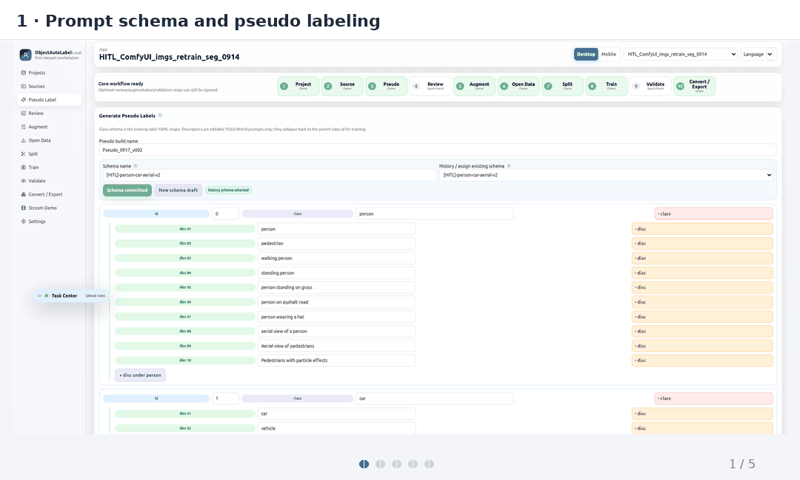

# ObjectAutoLabel

ObjectAutoLabel is a local-first object-detection dataset and model workflow. It runs a FastAPI backend, SQLite state, and a React/Vite WebUI for source registration, YOLO-World pseudo labeling, review, augmentation, split creation, YOLO training, validation, model conversion/export, and live stream inference.

Open the WebUI at:

```bash
http://127.0.0.1:8501/
```

## Interface Preview



The preview cycles through Pseudo Label, confidence review, bounding-box editing,
CUDA training, and model conversion/export without leaving this README.

## Start

### First installation

Use the launcher from the project root:

```bash
./run.sh
```

Choose `x86_64 / amd64` or `Jetson / aarch64` with the arrow keys and press
Enter. If the selected image is not installed, the launcher builds it with the
normal Docker layer cache, starts the service, and verifies API/CUDA access.

If the image already exists, bare `./run.sh` does not rebuild or start
anything. It prints the image id/creation time and points to the safe startup
and rebuild commands below.

### Normal startup after a reboot

```bash
./run.sh --up
```

`--up` uses the existing image and never rebuilds it. If the image is missing,
the command stops and asks you to run `./run.sh` for first installation.

### Rebuild after source or dependency changes

```bash
./run.sh --rebuild
```

`--rebuild` keeps Docker layer cache enabled, rebuilds the selected platform
image, starts it, and verifies API/CUDA access. It does not use `--no-cache` and
does not prune images, volumes, datasets, or models.

Useful commands:

```bash
./run.sh --status
./run.sh --logs
./run.sh --down
./run.sh --down_up
./run.sh --rebuild
./run.sh --detect
./run.sh --plan desktop
./run.sh --plan jetson
```

`--down_up` recreates the service from the existing image without rebuilding
the image.

`--plan` is a dry-run check. It prints the resolved runtime mode, architecture, compose file, and bind host without starting Docker.

## Runtime Modes

Desktop/x86_64:

```bash
./run.sh --mode desktop
./run.sh
```

Desktop mode uses `docker-compose.yml`, `Dockerfile`, and the x86 CUDA PyTorch base image.

Jetson/ARM64:

```bash
./run.sh --mode jetson
./run.sh
```

Jetson mode uses `docker-compose.jetson.yml`, `Dockerfile.jetson`, host networking, and NVIDIA ARM64 iGPU/L4T PyTorch images. The default Jetson base is `nvcr.io/nvidia/pytorch:25.06-py3-igpu`. Override when needed:

```bash
JETSON_BASE_IMAGE=nvcr.io/nvidia/l4t-pytorch:<tag> ./run.sh --rebuild
```

On Jetson, when `OBJECT_AUTOLABEL_BIND_HOST` is unset, `run.sh` detects the
primary LAN IPv4 and uses it (for example, `10.42.0.21`) so LAN access can
coexist with a Tailscale listener. Set `OBJECT_AUTOLABEL_BIND_HOST=<ip>` to
override that choice. The application verifies a configured non-loopback host
at startup and safely falls back to `127.0.0.1` if that address is no longer
bindable. Direct `docker compose` use without the launcher retains the compose
file's loopback default.

### Private Tailscale HTTPS

Start the WebUI, then publish only this app's dedicated HTTPS route to tailnet
members:

```bash
./run.sh --up
./run.sh --tailscale-up
./run.sh --tailscale-status
```

Use the printed `https://<device>.<tailnet>.ts.net:8501/` address rather than
a raw `100.x` address. When the app binds a LAN IP, its localhost proxy keeps
the Tailscale route targeting `127.0.0.1:8501`; when it binds loopback, Serve
targets the app directly. The launcher leaves shared port 443 and other routes
alone, and `--tailscale-down` removes only this exact 8501 proxy. It refuses
`--tailscale-up` if Funnel makes this exact hostname and port public, or if
Funnel status cannot be read; `--tailscale-status` reports public or unknown
access explicitly. Funnel routes on other ports do not affect this app route.
Confirm both
local and HTTPS health after a rebuild:

```bash
curl -fsS http://127.0.0.1:8501/api/health
curl -fsS https://<device>.<tailnet>.ts.net:8501/api/health
```

## Data Layout

The repository includes empty placeholder directories so the required layout is
visible immediately after cloning. Generated data and model binaries remain
ignored by Git.

```text
ObjectAutoLabel/
├── data/
│   ├── input/       # reusable source images and videos
│   ├── opendata/    # downloaded shared Open Data caches
│   └── projects/
│       └── <project-slug>/
│           └── output_model/ # this project's trained and converted artifacts
├── world_model/             # models used by the Pseudo page
│   ├── yoloe-26n-seg.pt     # default open-vocabulary checkpoint
│   ├── mobileclip2_b.ts      # YOLOE prompt encoder
│   ├── ViT-B-32.pt           # CLIP encoder
│   └── yolov8s-worldv2.pt    # optional YOLO-World v2 checkpoint
├── input_model/             # pretrained starting weights for the Train page
│   ├── yolo11n.pt            # default installer choice
│   └── yolo26n.pt            # optional newer Nano checkpoint
└── output_model/            # project model index and export packages
```

`data/projects/<slug>/` is owned by the application. Project deletion removes
that project's workspace, but it does not remove reusable files in
`data/input/` or shared caches in `data/opendata/`. Runtime diagnostics are
written to `logs/YYYY-MM-DD/`.

### Prepare source data and models

1. Put reusable image folders or videos beneath `data/input/`. For example:

   ```bash
   mkdir -p data/input/my_dataset
   cp -r /path/to/images/. data/input/my_dataset/
   cp /path/to/video.mp4 data/input/
   ```

2. Install an open-vocabulary model for the Pseudo page. The provided installer
   downloads checksum-verified checkpoints and matching prompt encoders:

   ```bash
   # YOLOE-26 Nano Seg + mobileclip2_b.ts + ViT-B-32.pt
   scripts/install-world-model.sh

   # Optional YOLO-World v2 Small; reuses/installs ViT-B-32.pt
   scripts/install-world-model.sh yolov8s-worldv2.pt
   ```

   To use your own approved compatible checkpoint, copy its `.pt` or `.pth`
   file and required prompt encoder into `world_model/`. Supported filenames
   include `yoloe-26*-seg.pt`, `yolov8*-worldv2.pt`, and
   `yolov8*-world.pt`/`.pth`.

   The catalog files come from the official
   [Ultralytics assets releases](https://github.com/ultralytics/assets/releases);
   the CLIP encoder comes from the URL encoded in OpenAI's published CLIP
   checksum. The installer verifies every download before making it visible to
   the application.

   | File placed in `world_model/` | Download source | Installed for |
   | --- | --- | --- |
   | `yoloe-26n-seg.pt` | [Ultralytics assets v8.4.0](https://github.com/ultralytics/assets/releases/download/v8.4.0/yoloe-26n-seg.pt) | Default YOLOE pseudo labeling |
   | `mobileclip2_b.ts` | [Ultralytics assets v8.4.0](https://github.com/ultralytics/assets/releases/download/v8.4.0/mobileclip2_b.ts) | YOLOE text prompts |
   | `ViT-B-32.pt` | [OpenAI CLIP](https://openaipublic.azureedge.net/clip/models/40d365715913c9da98579312b702a82c18be219cc2a73407c4526f58eba950af/ViT-B-32.pt) | YOLO-World text prompts |
   | `yolov8s-worldv2.pt` | [Ultralytics assets v8.3.0](https://github.com/ultralytics/assets/releases/download/v8.3.0/yolov8s-worldv2.pt) | Optional YOLO-World v2 pseudo labeling |

3. Install a pretrained detection checkpoint for the Train page. With no
   argument, the input-model installer downloads YOLO11n:

   ```bash
   # Default: input_model/yolo11n.pt
   scripts/install-input-model.sh

   # Optional: install YOLO26n too
   scripts/install-input-model.sh yolo26n.pt

   # Or install both catalog choices in one command
   scripts/install-input-model.sh yolo11n.pt yolo26n.pt
   ```

   Download references and model descriptions:

   | File placed in `input_model/` | Official download | Model guide |
   | --- | --- | --- |
   | `yolo11n.pt` | [Ultralytics assets v8.3.0](https://github.com/ultralytics/assets/releases/download/v8.3.0/yolo11n.pt) | [YOLO11](https://docs.ultralytics.com/models/yolo11/) |
   | `yolo26n.pt` | [Ultralytics assets v8.4.0](https://github.com/ultralytics/assets/releases/download/v8.4.0/yolo26n.pt) | [YOLO26](https://docs.ultralytics.com/models/yolo26/) |

   You may also copy another compatible `.pt` checkpoint into `input_model/`
   manually. The script's two catalog entries are SHA-256 verified and written
   atomically. Model binaries remain ignored by Git; `.gitignore` retains only
   each directory's placeholder.

4. Start or recreate the service. These folders are bind-mounted, so adding a
   model does not require rebuilding the image:

   ```bash
   ./run.sh --up
   # If the service is already open, refresh the browser to reload model lists.
   ```

Inside Docker, the folders are `/app/data`, `/app/world_model`,
`/app/input_model`, and `/app/output_model`. `world_model/` and `input_model/`
are mounted read-only; generated training and conversion artifacts are written
through the project workspace and indexed from `output_model/`.

**YOLO26n:** select `yolo26n.pt` in Train with the pinned Ultralytics 8.4.130
runtime. Its loss charts show Box / Class / **L1**, since the detection head is
DFL-free. Native small-target assignment and progressive dual-head training are
handled by Ultralytics; your selected optimizer remains in effect. Validate and
Stream report NMS-free inference for this model, where confidence filtering
still applies but NMS IoU suppression does not. ONNX/LiteRT exports retain the
model's postprocessing contract. See [compatibility and verification details](spec/references/yolo26-compatibility.md).

## Optional Google, Facebook, or LINE Sign-in

OAuth sign-in uses Authlib inside the existing FastAPI process. Copy `.env.example` to `.env`, configure an exact public URL and at least one provider credential pair, set a random session secret of at least 32 characters, then enable authentication and rebuild the selected image:

```bash
cp .env.example .env
# Edit .env without committing provider secrets.
./run.sh --rebuild
```

Register these callback paths with the matching provider:

```text
<PUBLIC_URL>/api/auth/callback/google
<PUBLIC_URL>/api/auth/callback/facebook
<PUBLIC_URL>/api/auth/callback/line
```

When authentication is enabled but no provider is fully configured, the login screen shows setup guidance and protected APIs remain locked. Authentication identifies the operator but does not partition projects by user.

Deleting a project package removes its DB rows, jobs, project workspace, and project model-index entry. It does not delete raw `data/input/`.

### World-model integrity and compatibility

The commands shown above install the checksum-verified default YOLOE-26 Nano
Seg checkpoint and prompt encoders, or the checksum-verified YOLO-World v2
Small checkpoint:

```bash
scripts/install-world-model.sh
scripts/install-world-model.sh yolov8s-worldv2.pt
```

The installer verifies SHA-256 for both existing and downloaded catalog
artifacts before using them, then atomically renames verified downloads. A
custom asset URL must be paired with its explicit expected SHA-256 environment
variable. The current installer intentionally rejects YOLO-World v2 Medium,
Large, and Extra-Large because this repository has no locally attested catalog
hashes for them. Those filenames remain backend-recognized when an operator
manually supplies an approved trusted artifact through its own hash-controlled
workflow. Other compatible manually supplied weights may still be copied into
`world_model/`; the Pseudo page shows only supported filenames and refuses to
start without one.
The directory is bind-mounted read-only at `/app/world_model` inside the
container. Adding a weight file does not require rebuilding the Docker image;
refresh the Pseudo page to update its model list.

### Input-model integrity and compatibility

`scripts/install-input-model.sh` installs the default `yolo11n.pt`, or accepts
`yolo11n.pt` and `yolo26n.pt` as explicit arguments. It downloads from official
Ultralytics release assets, verifies the catalog SHA-256, and atomically moves
the file into `input_model/`. It refuses a corrupt existing file instead of
overwriting it. Custom mirrors require the corresponding `YOLO11N_URL` and
`YOLO11N_SHA256`, or `YOLO26N_URL` and `YOLO26N_SHA256`, environment variables.
The Train page discovers compatible `.pt` files from this directory after a
browser refresh.

## Workflow

1. Create or select a project.
2. Sources: choose image folder or video, then run `Process & analysis`.
3. Pseudo: commit a class schema, name the pseudo build, and run YOLO-World.
4. Review: inspect the confidence map and adaptive object-size distribution, then spot-check/edit boxes. After zooming, drag empty image space to pan; Shift+drag selects boxes and dragging a box moves it. Right-click actions open beside the pointer. Labeled data remains trainable without checked/not-checked status gates.
5. Augment: choose `Skip augment` for a source/pass-through build, or create x3/x5/x8/x10 augmented builds.
6. Open Data (optional): use built-in VisDrone or paste one Ultralytics Platform Dataset URL. Compatible Detect datasets reuse the same class mapping, percentage, preview, Review, version and Split flow; other task types are blocked before download.
7. Split: drag saved Pseudo, Augment and optional Open Data modules into a composition (or use the selection buttons). Inspect counts/settings, name it, then **Save & assign composition** and **Build New Split Version**. Augment brings its recorded Pseudo parent; only the chosen Open Data version is added, preserving official train/validation groups.
8. Train: name the run, choose the input model and optimizer (SGD, MuSGD, Adam, or AdamW), and watch box/class/DFL loss charts. Choose an assigned or another saved, non-outdated Split version. Review/Open Data changes may require a new Split.
9. Validate: choose a current-project model source and run random-sample inference.
10. Convert / Export: on x86_64, create ONNX FP32 and/or LiteRT FP32 conversion packages with schema metadata and Netron preview, then download one structured ZIP containing native PT, converted artifacts, training evidence, arguments, classes, and metadata. On Jetson/aarch64, copy the `.pt` checkpoint to an x86_64 host and convert it there.
11. Stream Demo: run a supported PT, ONNX, or LiteRT artifact against a host camera or uploaded video with live confidence and IoU controls.

Producing steps retain lineage. **Assign & history** at the page footer persists
version choices across tabs and reloads. Assigned project cards have a red
outline. Saved combinations can be reassigned or deleted; deleting a combination
keeps its built Split snapshots and training results. Deleting a build instead
removes its dependent downstream history after confirmation.

Each composition uses one Pseudo → optional Augment branch plus one optional
Open Data version. New Pseudo runs retain annotation snapshots for historical
Augment/Split inputs. If a legacy Pseudo run's original labels were already
overwritten, use its retained Augment build or regenerate Pseudo. Review edits
the live image queue; assigning an old Pseudo version selects downstream input.

Model conversion is intentionally x86_64 FP32-only. Converter dependencies are installed when the desktop image is built, and Ultralytics package auto-install is disabled; a conversion request never installs packages at runtime. Existing historical package rows remain readable even if they contain formats or precisions that are no longer offered for new conversions.

## Settings

The Settings page is the workflow control center:

- Workflow defaults: pseudo model, train input model, augment default, split ratio, train device.
- Project storage: active project folder and artifact counts.
- Runtime deployment: Desktop x86_64 vs Jetson ARM64 guidance.
- Model inventory: world, input, and output model lists.

Settings defaults are UI conveniences. Each workflow tab still shows the exact build input before running.

### Reproducible CUDA training

For a bounded acceptance run, use one isolated project per lineage, register a
source only once, and keep generated pseudo labels, splits, and weights inside
that project. The retained 0629 example is documented in
[the dual-training acceptance report](docs/verification/2026-08-30-0629-dual-training-acceptance.md).

Its approved input is `yolov8n_pretrain_8020.pt`, with one epoch, image size
640, batch 8, CUDA, patience 10, SGD, `lr0=0.01`, and `lrf=0.01`. For the
final audited retry, the API request explicitly used `rect=false` and
`amp=false`. Those API fields default to `true`; use `diagnostics=true` only
for a focused investigation, because it adds aggregate optimizer/gradient/EMA
evidence to the job result without changing the selected model. Always retain
the run record, `args.yaml`, metrics, `best.pt`, `last.pt`, and validation
preview before choosing a model for deployment.

### Responsive Review controls

At narrow widths the Review toolbar uses two rows: view and save actions
first, then Select/Draw/Pan and shortcuts. The groups stack below 900px,
ordinary controls retain 44px touch targets, and short panel actions stay
content-sized above 480px. At 480px and below, primary panel actions may fill
the available width. Long active-project names wrap rather than creating page
overflow.

## Verification

Common local checks:

```bash
bash -n run.sh scripts/detect-runtime.sh scripts/verify-runtime.sh
pytest -q
npm --prefix frontend test
npm --prefix frontend run build
```

Verify the running service and CUDA:

```bash
scripts/verify-runtime.sh --quick jetson
```

Run a bounded one-epoch YOLO CUDA training smoke test:

```bash
scripts/verify-runtime.sh --train jetson
```

The training smoke test uses the smallest local `.pt` file in `input_model/`;
it never downloads weights or falls back to CPU.

Dependency files are platform-specific: `requirements.txt` is for the
x86_64/desktop CUDA image and includes its FP32 conversion stack, while
`requirements-jetson.txt` keeps Jetson's NVIDIA PyTorch-compatible
`numpy>=1.26,<2` and bounded OpenCV version without the conversion stack. Do
not copy one file over the other; rebuild the selected image after
intentionally changing its dependency file. Neither runtime installs converter
packages on demand.

## License and source availability

ObjectAutoLabel is licensed under the [GNU Affero General Public License v3.0](LICENSE).
You may use, study, modify, and redistribute it under the terms of that
license. The complete source for the official public build is available at
[github.com/a0665x/ObjectAutoLabel](https://github.com/a0665x/ObjectAutoLabel).
Historical revisions remain governed by the license file distributed with
those revisions; this license change does not retroactively withdraw rights
already granted for earlier copies.

If you operate a modified version over a network, you must preserve a prominent
source-code offer and provide the complete corresponding source for the exact
version users interact with, as required by AGPL-3.0 section 13. This includes
your application changes and the scripts and configuration needed to build and
run that version. Operators publishing a fork should update the in-app source
link to point to their corresponding source.

### Ultralytics attribution

This project uses the
[Ultralytics](https://github.com/ultralytics/ultralytics) Python package for
YOLO training, validation, inference, and model export. Ultralytics software
and its default model licensing are AGPL-3.0 unless a separate Ultralytics
commercial license applies. See the
[Ultralytics licensing page](https://www.ultralytics.com/license) and its
[AGPL-3.0 terms](https://www.ultralytics.com/legal/agpl-3-0-software-license).

Ultralytics states that pretrained models and models produced or fine-tuned
with its training code are covered by its AGPL-3.0 licensing by default.
Anyone distributing or deploying trained `.pt`, ONNX, LiteRT/TFLite, or other
exported artifacts should therefore provide the applicable corresponding
source under AGPL-3.0 or obtain an appropriate Ultralytics Enterprise/R&D
license for proprietary use.

### Third-party models and datasets

AGPL-3.0 licensing of ObjectAutoLabel does not relicense datasets, pretrained
weights, model architectures, prompt encoders, fonts, or other third-party
assets. Each asset keeps its own copyright, license, attribution, commercial
use, privacy, and redistribution conditions. Operators are responsible for
checking those terms before downloading, training, publishing, or selling a
model. See [THIRD_PARTY_NOTICES.md](THIRD_PARTY_NOTICES.md) for the primary
dependency notice.
