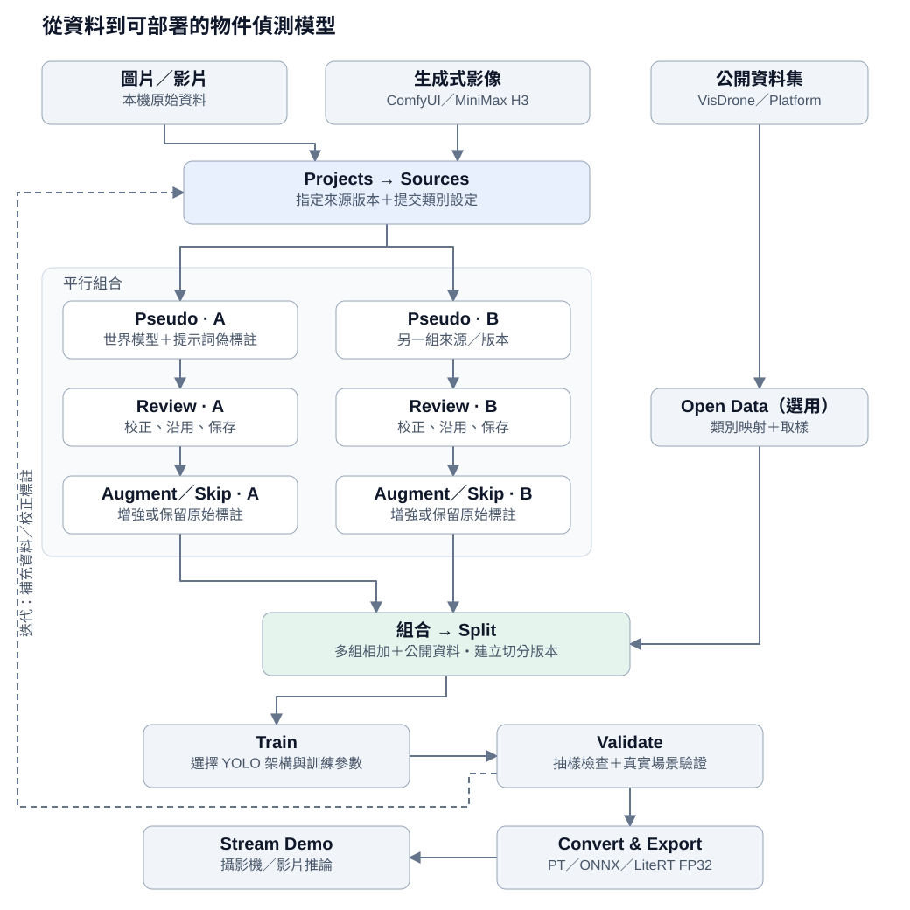

# ObjectAutoLabel

[English](README.md) · 繁體中文

本機優先的物件偵測資料與模型工作台：從圖片／影片、偽標註、人工校正到資料增強、切分、YOLO 訓練及模型匯出，在同一個 WebUI 完成。

## 專案目的

- **快速偽標註與 YOLO 訓練**：使用提示詞驅動的視覺世界模型（YOLO-World／YOLOE）快速產生物件框與偽標籤，再訓練 YOLO11、YOLO26 等相容的 YOLO 架構。
- **本地化、可由 API 驅動的迭代平台**：標註與訓練留在自己的主機，本地 AI Agent 可透過 REST API 產生標註、建立 Split、提交訓練與讀取結果。目前尚未內建 MCP server。
- **生成式資料快速建立專用模型**：將 ComfyUI 產出的圖片，或 [MiniMax H3 影片](https://comfy.org/minimax-h3/)抽幀後匯入，直接進行偽標註與指定物件的 YOLO 訓練，不必先搭建模擬器或額外的 sim2real 轉換流程；真實場景表現仍須驗證。


## 快速開始

需要 Linux、Docker Compose 與 NVIDIA GPU 執行環境（驅動及 NVIDIA Container Toolkit）。支援 x86_64 桌機與 Jetson ARM64；Jetson 映像須符合主機的 JetPack／L4T 版本。

```bash
git clone https://github.com/a0665x/ObjectAutoLabel.git
cd ObjectAutoLabel

# 安裝偽標註模型與提示詞編碼器；首次下載需要網路
scripts/install-world-model.sh

# 安裝 YOLO11n 訓練起始權重
scripts/install-input-model.sh

# 首次安裝：選擇平台、建立映像並啟動
./run.sh
```

開啟 [http://127.0.0.1:8501/](http://127.0.0.1:8501/)。Jetson 的區網位址以啟動輸出為準。

`./run.sh` 只在映像不存在時建立並啟動；已有映像時，使用下列指令：

| 操作 | 指令 |
| --- | --- |
| 啟動／重開機後啟動，不重建 | `./run.sh --up` |
| 更新程式後重建並啟動 | `./run.sh --rebuild` |
| 查看狀態／日誌 | `./run.sh --status` ／ `./run.sh --logs` |
| 停止服務 | `./run.sh --down` |
| 指定平台 | `./run.sh --mode desktop` ／ `./run.sh --mode jetson` |

重建會中斷執行中的工作；請先確認訓練等任務已結束。重建不會清除資料與模型。

## 準備資料與模型

將圖片資料夾或影片放入 `data/input/`，再到 Sources 選擇。容器內對應路徑為 `/app/data/input/`。

```text
data/input/        原始圖片與影片
data/projects/     各專案的圖片、標註、切分與模型成果
data/opendata/     共用的公開資料快取
world_model/       偽標註模型及提示詞編碼器
input_model/       訓練起始權重
output_model/      專案模型索引
```

可選模型：

```bash
# 改用 YOLO-World v2 Small 偽標註
scripts/install-world-model.sh yolov8s-worldv2.pt

# 加入 YOLO26n 訓練權重
scripts/install-input-model.sh yolo26n.pt
```

安裝腳本會驗證下載檔案的 SHA-256。模型目錄已掛載到容器，新增模型後重新整理頁面即可，不必重建。資料、權重、密鑰與執行日誌不會提交到 Git。

## 操作流程



[以 draw.io 編輯流程圖](docs/diagrams/workflow.drawio) · 內含 English／繁體中文頁面

- **Sources → Pseudo**：處理圖片或抽取影片影格，指定 Source 版本並提交類別與提示詞。同一路徑再次處理時會先要求確認。
- **Pseudo → Review**：可合併同類提示詞的框，並用直方圖區間排除過大的框。沿用（Reuse）會複製最近保存的同來源／版本標註，空白圖片也能使用；同類別 IoU 超過門檻時保留當前框（預設 0.8），檢查後仍需保存。
- **平行組合 → Split**：可加入多組 Pseudo → Augment；Skip augment 建立不增強的版本。Open Data 完成類別映射與取樣後直接加入，不經 Pseudo／Augment；Platform 需 API key。
- **Split → Train**：保存並指定組合，再建立 Split。Assign & history 保留版本選擇；上游修改可能使下游 Split 過期。在 Task Center 查看訓練進度或取消。
- **Validate → Export／Stream Demo**：抽樣驗證後下載模型包，或以攝影機／影片推論。x86_64 支援 ONNX／LiteRT FP32；Jetson 的 PT 權重需移到 x86_64 主機轉換。

## API 與本地 AI Agent

[互動式 API 文件](http://127.0.0.1:8501/docs) · [OpenAPI 規格](http://127.0.0.1:8501/openapi.json) · [端點說明](spec/API.md)

長時間任務會回傳 job ID，可用 `GET /api/jobs/{job_id}` 查詢狀態與結果。本地 Agent 可據此串接「產生標註 → 訓練 → 評估」迭代；MCP 需另行實作轉接層。目前 ComfyUI 的串接方式是匯入生成檔案，並非內建生成節點。

## Review 快捷鍵

| 操作 | 快捷鍵 |
| --- | --- |
| 選取／畫框／平移 | `D` ／ `B` ／ `H` |
| 保存並下一張 | `N` 或 `Shift+S` |
| 保存 | `Ctrl/Cmd+S` |
| 復原／重做 | `Ctrl/Cmd+Z` ／ `Ctrl/Cmd+Shift+Z` |
| 複製／貼上／複製所選框 | `Ctrl/Cmd+C` ／ `Ctrl/Cmd+V` ／ `Ctrl/Cmd+D` |
| 刪除所選框 | `Delete` ／ `Backspace` |
| 多選／縮放 | `Shift+拖曳` ／ `Ctrl+滾輪` |
| 移除專案內圖片（需確認） | `Shift+X` |

沿用後可復原；重複按沿用不會再加入相同框。右鍵可開啟框的編輯選單。

## 使用注意

- 刪除專案或 Source history 不會刪除 `data/input/` 原始檔案；刪除上游歷史會連帶刪除依賴它的下游成果，請確認提示內容。
- 服務以可信任的本機／私人網路操作為主。CLI 是具掛載資料存取權的真實 shell，需保護其 token；不要直接對公開網路開放。
- 私人遠端存取可使用 `./run.sh --tailscale-up`。選用登入設定見 [.env.example](.env.example)；登入目前不提供使用者間的專案隔離。

## 開發與文件

FastAPI + SQLite + React／TypeScript + Vite。開發細節見 [專案結構](spec/PROJECT_MAP.md)、[部署與排錯](spec/OPERATIONS.md)及 [CLI 操作](cli_workspace/README.md)。

```bash
# 需先安裝相應測試依賴；後端建議使用專案的 Docker 環境
pytest -q
npm --prefix frontend test -- --run --maxWorkers=1
npm --prefix frontend run build
```

## 授權

[AGPL-3.0](LICENSE)。透過網路提供修改版服務時，須依授權提供相應原始碼。第三方授權見 [THIRD_PARTY_NOTICES.md](THIRD_PARTY_NOTICES.md)。
